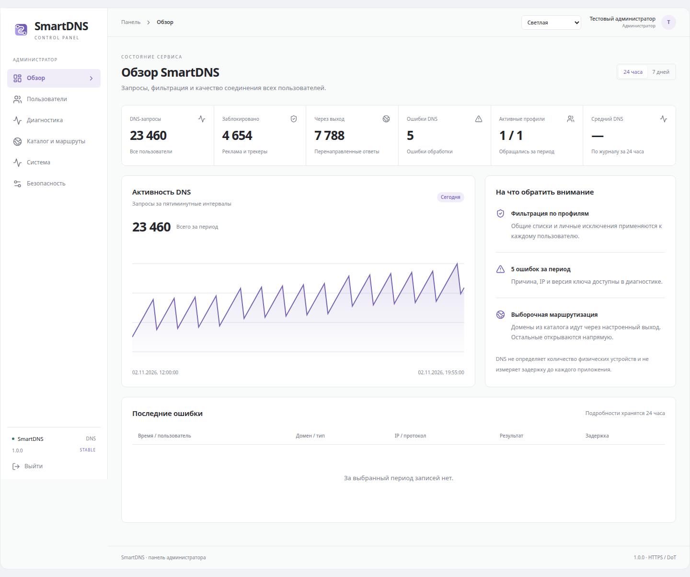

# SmartDNS

Self-hosted encrypted DNS, ad filtering and selective HTTPS forwarding, with an administrator dashboard. One DNS credential works across multiple devices; recipients do not need a website account.



*Screenshot uses an isolated synthetic demonstration database.*

## What it does

- DoT for Android/system resolvers, DoH for browsers and compatible routers, and a shared Apple configuration profile.
- Administrator-only user management, per-user filtering and exceptions, credential rotation, optional TOTP and recovery codes.
- Global activity charts, DNS error reasons, per-user source-IP history and temporary proxy admissions. Detailed events: 24 hours; aggregates: seven days.
- IPv4/IPv6 ingress; a local exit or an existing tunnel to one foreign exit. Forwarded HTTPS remains end-to-end encrypted.
- Validated daily catalog updates and AdGuard DNS Filter + HaGeZi Multi PRO.
- Automated wildcard certificate renewal, verified release installation, upgrades and rollback.

## Install on your VPS

Supported automated installation: **Ubuntu 24.04 or 26.04 LTS, x86_64**, at least 1 GiB RAM and 2 GiB free disk. Use your own domain and public IPv4; IPv6 is optional. Inbound TCP 443 and 853 are required. ACME uses DNS-01; port 80 is not required for SmartDNS.

1. Download the archive and `SHA256SUMS` from a validated [release](../../releases). Verify the archive checksum and build provenance.
2. Extract it into an empty directory and read `manifest.json`. Use its exact commit and the published checksum:

```sh
sudo python3 scripts/setup.py \
  --artifact /path/to/smartdns-release.tar.gz \
  --sha256 PUBLISHED_SHA256 --commit MANIFEST_COMMIT \
  --domain dns.example.com --ipv4 YOUR_PUBLIC_IPV4
```

The installer requests the ACME email, prints the DNS records to create, configures isolated components and asks for the administrator password privately. The default certificate flow requires one CNAME delegation to acme-dns. Node is not required on the VPS. Never paste DNS/API secrets into public issues or shell arguments.

**Shared VPS:** use `--mode shared` to prepare configuration fragments; merge them with your existing ingress and firewall before starting the application. Existing listeners and unrelated VPNs must be preserved. See [installation](docs/INSTALLATION.md) for the complete procedure and existing DNS-provider plugin support.

## Documentation

[Configuration](docs/CONFIGURATION.md) · [architecture](docs/ARCHITECTURE.md) · [operations and recovery](docs/OPERATIONS.md) · [Ubuntu system DNS](docs/UBUNTU.md) · [migration](docs/MIGRATION.md) · [privacy](docs/PRIVACY.md) · [security](SECURITY.md) · [contributing](CONTRIBUTING.md) · [release validation](docs/VALIDATION.md)

## Boundaries

DNS selects hostnames; it cannot route hardcoded IPs, arbitrary game protocols, MTProto or calls. Catalog membership does not establish native-app compatibility. Browser/app account region, codecs and exit-IP reputation can affect access. DNS cannot remove all advertisements.

Forwarding admission uses the observed public source IP. People behind the same NAT share that boundary. Only the observed address family is admitted: routed answers use IPv4 for IPv4 DNS clients and IPv6 for IPv6 DNS clients. IPv4-only applications may need an IPv4 DNS transport. Ordinary IPv6 answers remain intact.

A real VPN may override DNS or use a different HTTPS source address. Configure a consistent DNS/HTTPS egress; universal compatibility is not claimed. One ingress and one exit remain single points of failure.

The bundled routing policy includes protected categories omitted from the dashboard. Its sources remain inspectable; dashboard visibility is not a complete policy inventory.

The repository contains no production configuration, databases, certificates or live connection links. License: [MIT](LICENSE). The GitHub owner's public identity and required attribution remain visible.
